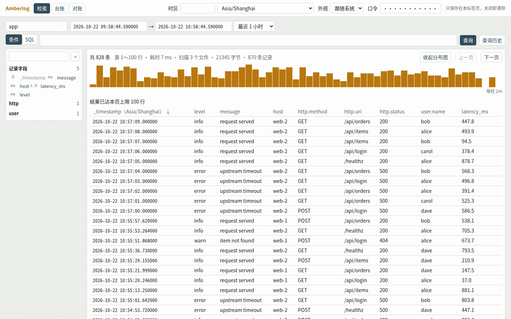
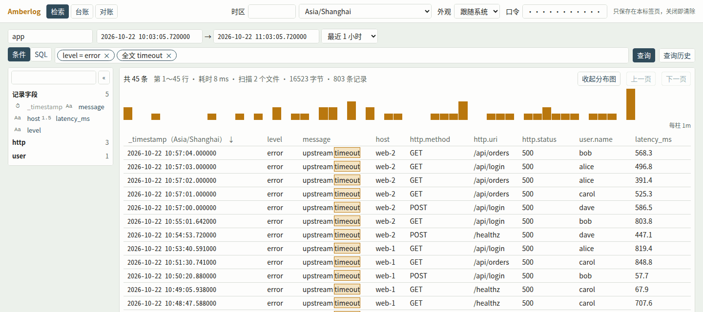
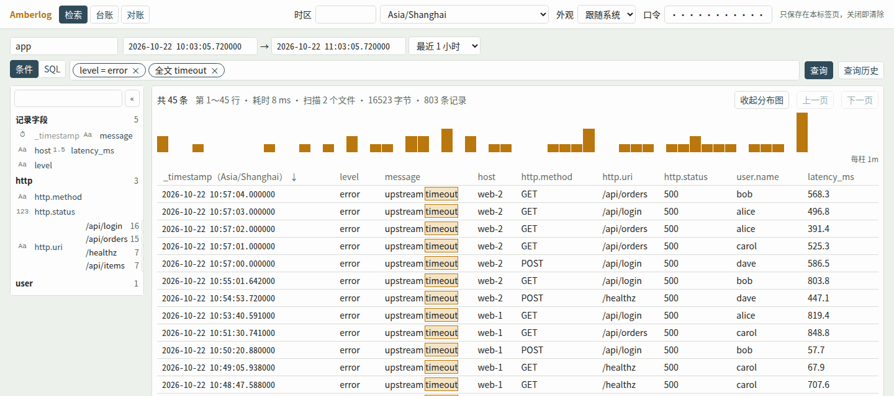
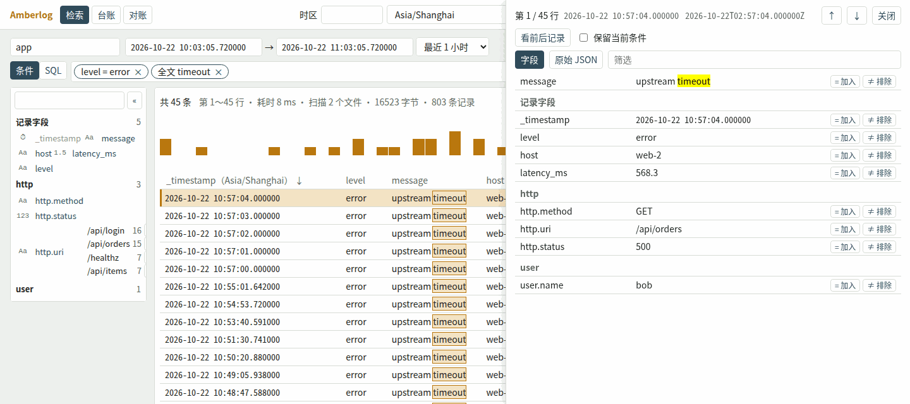
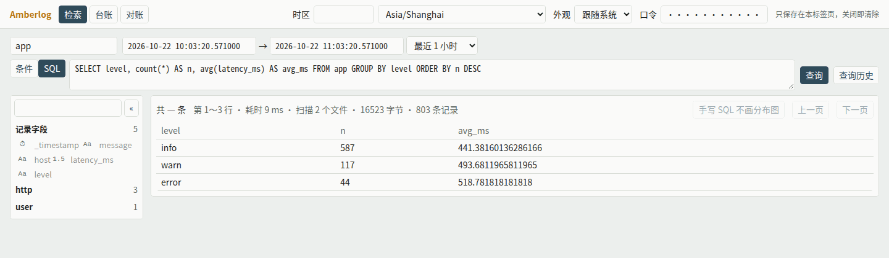
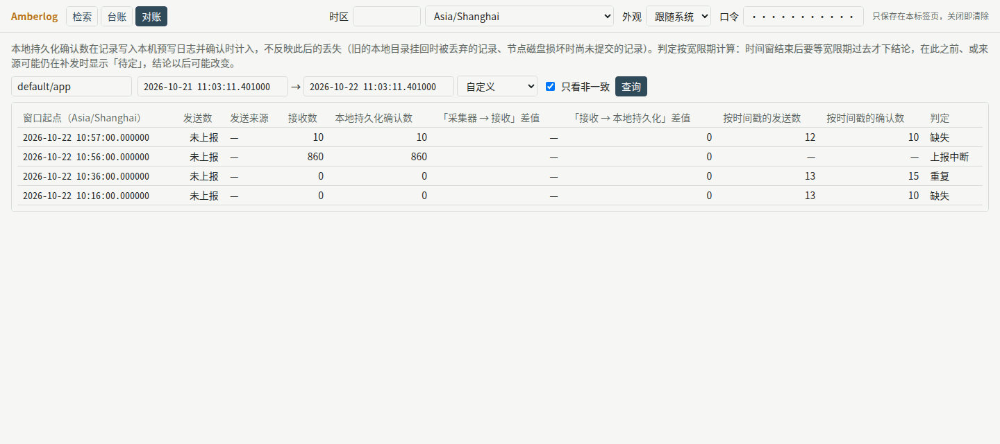

# 检索界面与告警使用说明

[English](ui-and-alerting.md)

> 适用于 Amberlog 0.1.0。

本文写给用 Amberlog 查日志、看数据资产与对账、配告警的人。前半部分讲浏览器里的检索界面，它有检索、台账、对账三屏；后半部分讲定时告警怎样配，通知怎样收。

文中的截图与输出都来自一次实际运行：本地磁盘存储，合成的测试数据，浏览器时区设为 Asia/Shanghai。HTTP 接口见 [API 参考](api.zh-CN.md)，配置项见 [配置项参考](configuration.zh-CN.md)。

## 1. 打开界面

在浏览器里打开 `https://<Amberlog 的地址>/ui`。

- 打开页面不需要令牌，页面本身不含数据。查询时才要令牌：在右上角的「口令」框里填 `auth.token` 的值。
- 口令只保存在当前标签页里，关闭标签页即清除。它不写进地址栏、Cookie 或浏览器的持久存储。口令错了或没填时，口令框旁显示「口令无效或未填写」。
- 「时区」决定界面上的时刻按哪个时区显示，默认是浏览器的时区。时刻写作 `YYYY-MM-DD HH:MM:SS.ffffff`，精确到微秒；鼠标悬停在时刻上，能看到它的 UTC 写法。
- 「外观」有跟随系统、浅色、深色三种。
- 时区、外观与查询历史保存在浏览器里，下次打开沿用。
- 页面所需的脚本、样式与字体都在页面里，不访问 Amberlog 以外的任何地址，内网里也能用。
- 三屏之间切换不发请求，各屏已填的内容与结果都保留。

## 2. 检索屏



### 2.1 选数据集与时间范围

1. 在左上角的数据集框里选或填一个数据集的名字，例如 `app`。候选取自台账。
2. 选时间范围。快捷项有最近 15 分钟、1 小时、6 小时、24 小时、7 天、30 天，默认最近 1 小时。也可以在起止框里直接写时刻，写法是 `YYYY-MM-DD HH:MM`、`YYYY-MM-DD HH:MM:SS` 或带小数秒，按所选时区理解。
3. 点「查询」。

结果区上方显示总条数、本页的行范围、耗时与扫描量。每页 100 行，用「上一页」「下一页」翻页。

### 2.2 条件模式

条件模式下，在条件框里输入一个条件，回车，它就成为条件框里的一枚标签。多个条件之间是「并且」。每枚标签可以单独删掉。

| 输入 | 成为 |
|---|---|
| `level = error` | 字段条件。运算可以是 `=`、`!=`、`<`、`<=`、`>`、`>=`、`LIKE` |
| `user.name IS NULL`、`user.name IS NOT NULL` | 字段为空或不为空 |
| `timeout` | 全文条件：任一文本字段含这个词 |
| `"level = error"` | 用双引号括起来，整段按全文条件处理 |

- 取值的写法：字段是文本类型时，`code = 500` 里的 `500` 按文本比较；字段是数值类型时按数值比较。取值用双引号括起来，例如 `code = "500"`，就一律按文本比较。运算是 `LIKE` 时，取值一律按文本。
- 输入时，界面提示字段名与运算。字段栏里已展开某个字段的常见取值时（第 2.4 节），也提示这些取值。提示的最后一项是「按全文检索」。
- 新加入或删掉、还没查询的条件，标签显示为虚线，「查询」旁有一个圆点。点「查询」后才生效。



全文检索没有索引，要扫描范围内的全部文本：

- 加入第一个全文条件时，长于 24 小时的时间范围自动收到最近 24 小时。
- 有全文条件时，时间范围最长 7 天，超过时「查询」不可用。先用字段条件缩小范围，或分段查询。

### 2.3 分布图

条件模式下，结果上方的柱状图显示每个时间段的记录数，右下角写每根柱代表多长时间。

- 点一根柱，或拖选几根柱，时间范围就改成这一段，并重新查询。
- 「收起分布图」可以收起它，收起后不再请求分布数据。
- 手写 SQL 时不画分布图。

### 2.4 结果表与字段栏

- 点 `_timestamp` 列头，在新到旧与旧到新之间切换。
- 每一列可以隐藏，只在本次页面有效。
- 全文条件匹配的部分在结果里被标出。

左边的字段栏列出当前数据集的全部字段，按名字中第一个 `.` 之前的部分分组，每个字段前有类型标记。

- 点一个字段，列出它在最近一次查询的条件与时间范围内最常见的 10 个取值和条数。只在条件模式下可用。
- 每个取值旁有「=」「≠」，点了就加入一个对应的条件。
- 取值太多、统计超过内存上限时，显示「取值太多，无法统计」。



### 2.5 单条详情

点结果表的一行，右侧打开这条记录的详情。

- 「字段」页列出全部字段，`message` 在前，其余按组列出。每个字段有「= 加入」「≠ 排除」，加入的条件是虚线标签，点「关闭并查询」生效。
- 「原始 JSON」页显示这条记录在检索应答里的原样。
- 按 ↑、↓ 换到上一条、下一条。
- 「看前后记录」显示这条记录之前与之后各约 20 条（各在 1 小时以内），便于看上下文。默认不带当前的条件；勾选「保留当前条件」时只看满足条件的记录。「返回检索结果」回到原来的结果。只在条件模式下可用。



### 2.6 SQL 模式

点「SQL」切到 SQL 模式，直接写 SQL。从条件模式切过来时，界面把当前的条件写成对应的 SQL。



- 支持的 SQL 见 [API 参考](api.zh-CN.md) 第 4.3 节。不支持的写法显示「查询写法有误」与原因，例如 `round` 函数不支持。
- 时间范围仍由上方的时间框决定。
- 不画分布图，结果不能按列头排序。
- 从 SQL 模式切回条件模式时，改过的 SQL 会被放弃，界面先请你确认。

### 2.7 查询历史

每次查询都记入「查询历史」，保存在浏览器里。选一项，检索屏恢复成那次查询的设定。「清空查询历史」删掉全部记录。

### 2.8 出错时显示什么

| 显示 | 原因与处理 |
|---|---|
| 口令无效或未填写 | 口令错了或没填 |
| 查询写法有误 | SQL 或条件写法不被支持，下面列出原因 |
| 这次查询需要的内存超过上限 | 缩小时间范围，或去掉全文条件、改用字段条件 |
| 服务繁忙：同时执行的查询已满 | 同时执行的查询数到了上限，倒计时结束后再查 |
| 暂时无法读取数据 | 对象存储不可访问，或服务正在停止 |
| 无法连接服务 | 浏览器连不上 Amberlog |

查询超过 3 秒还没结果时，显示已用的秒数和「取消」。取消以后，服务端可能还在执行这次查询，马上重查可能提示服务繁忙。

## 3. 台账屏

台账屏列出每个数据集的概况。选时间范围（默认最近 24 小时），点「查询」。


| 列 | 含义 |
|---|---|
| 状态 | 「未停用」，或因格式版本不兼容、清单不可读而「已停用」 |
| 首条、末条数据时间 | 数据集里最早、最晚的 `_timestamp` |
| 条数、字节数 | 热层与冷层合计 |
| 所在层 | 热层、热层（待入湖）、冷层、热层与冷层 |
| 待入湖条数 | 已到入湖时间、还没入湖的记录数 |
| 保留期、到期日 | 配了 `retention.period` 时才有。到期日是最早数据的到期时刻 |
| 来源 | 时间范围内按发送时刻上报过发送数的来源（第 4.1 节） |
| 对账状态 | 「三方」：有按发送时刻的发送数；「两方（发送计数缺失）」：没有；「计数不可读」 |
| 各判定的时间窗数 | 时间范围内各判定的分钟数，判定见第 4.2 节 |
| 上报中断的来源数、按时间戳上报的来源 | 见第 4.2 节 |

每行右边有两个跳转：「对账」切到对账屏，查这个数据集同一段时间；「检索」切到检索屏，查这个数据集。台账屏只能看，不能改。

台账列出全部数据集。持有令牌的人都能看到这份清单。

## 4. 对账屏

对账屏按分钟列出一个数据集的计数：采集端说发了多少，Amberlog 收到多少、确认多少，两者是否对得上。选数据集与时间范围，点「查询」。勾选「只看非一致」，只列判定不是「一致」的分钟。



### 4.1 让对账有数据

对账靠采集端上报自己发了多少。只写入、不上报时，对账屏只有接收数与确认数。

1. 写入请求带请求头 `X-Amberlog-Source: <来源>`，例如机器名（[API 参考](api.zh-CN.md) 第 2.5 节）。
2. 采集端每分钟用 `_sent` 上报这个来源发出的条数（[API 参考](api.zh-CN.md) 第 3 节）。
   - `basis` 为 `timestamp`：按记录的 `_timestamp` 所在分钟统计。只有这种上报参与判定。
   - `basis` 为 `delivery`（默认）：按采集端自己约定的口径统计，只在「发送数」一列里与接收数并列显示。

| 列 | 含义 |
|---|---|
| 窗口起点 | 这一分钟的起点 |
| 发送数、发送来源 | 按发送时刻上报的发送数之和与来源；没有上报时显示「未上报」 |
| 接收数、本地持久化确认数 | 按 Amberlog 收到请求的时刻归到这一分钟的条数 |
| 两个差值 | 发送数减接收数、接收数减确认数 |
| 按时间戳的发送数、按时间戳的确认数 | 判定所比的两个数，按 `_timestamp` 所在分钟统计 |
| 判定 | 见第 4.2 节 |

### 4.2 判定的读法

| 判定 | 含义 |
|---|---|
| 待定 | 这一分钟结束后还没过宽限期（`reconciliation.grace`，默认 5 分钟），或有来源正在补发，暂不下结论 |
| 一致 | 每个按时间戳上报的来源，确认数都等于它上报的发送数 |
| 缺失 | 有来源的确认数少于它上报的发送数 |
| 重复 | 没有缺失，但有来源的确认数多于它上报的发送数 |
| 上报中断 | 有来源在前 24 小时内上报过，这一分钟却没有上报 |
| 不可判定 | 这一分钟没有来源按时间戳上报，也没有上报中断 |

读判定时要知道：

- 判定只比较采集端上报的数与 Amberlog 确认的数。「一致」说明两者相等，不能证明采集端没有漏掉日志；「缺失」说明两者不等，原因要到采集端去查。
- 判定在查询时按当时的计数计算。迟到的记录补齐以后，「缺失」会变成「一致」。补写历史数据以后，要等一个宽限期判定才稳定。
- 本地持久化确认数在记录写入本机 WAL 并确认时计入，不反映此后的丢失，例如本地磁盘损坏时还没提交的记录。对账屏上方常显这段说明。
- 界面不用颜色区分判定，以文字为准。

## 5. 定时告警

Amberlog 可以按固定周期执行一条 SQL，结果满足条件时，向一个 HTTP 地址发 `POST` 请求（webhook）。规则写在配置文件里，改规则要重启。只有写入实例（`amberlog serve`）评估规则。

### 5.1 写一条规则

```toml
[alerts]
max_concurrency = 1

# 每分钟看一次最近 2 分钟的 error 记录，超过 3 条就通知。
[[alerts.rules]]
name = "error_burst"
interval = "1m"
window = "2m"
sql = "SELECT count(*) AS n FROM app WHERE level = 'error'"
condition = { column = "n", op = ">", threshold = 3 }
webhook_url = "https://hooks.example.com/amberlog"
webhook_headers = { "Authorization" = "Bearer <接收端的令牌>" }
```

| 字段 | 必填 | 说明 |
|---|---|---|
| `name` | 是 | 小写字母、数字、下划线，最长 64 个字符；不以 `amberlog_` 开头，不叫 `missed_collection`，各规则不重名 |
| `interval` | 是 | 评估周期，整分钟，`1m`～`24h`。评估在 UTC 的整倍数时刻进行，周期 5 分钟就是每小时的 :00、:05…… |
| `window` | 否 | 查询范围的长度，整分钟，`1m`～`7d`，默认等于 `interval`。时刻 T 的评估查 `[T − window, T)` |
| `sql` | 是 | 一条 SQL，写法同检索 |
| `condition` | 是 | 行数条件或列条件，见第 5.2 节 |
| `webhook_url` | 是 | 接收通知的地址，`https://` 或 `http://` |
| `webhook_headers` | 否 | 自定义请求头，例如接收端要的令牌 |
| `enabled` | 否 | 默认 `true`。为 `false` 的规则照常校验，不评估 |

- 最多 100 条规则。`alerts.rules` 与 `webhook_headers` 只能写在配置文件里，不能用环境变量。
- 规则写错时，进程以退出码 2 退出，stderr 指出出错的规则。启动时只检查 SQL 的写法；SQL 引用的数据集与列存不存在，到评估时才知道。
- 上线前，先用检索屏或 `_search` 以同样的 SQL 与时间范围试一遍。评估看到的结果与这样查到的相同。

### 5.2 两种条件

- **行数条件** `{ rows = "> 0" }`：以结果的行数比较。
- **列条件** `{ column = "n", op = ">", threshold = 3 }`：结果中任一行的这一列满足比较，就算命中。这一列要是整数或浮点数。

比较符是 `>`、`>=`、`<`、`<=`、`=`、`!=`。

不聚合的 SQL 最多返回 `query.max_size` 行（默认 10000），超出部分被截断。所以要按条数判断，在 SQL 里写 `count(*)`，再用列条件比较，像第 5.1 节的例子那样。关键字告警也写在 SQL 里，例如 `WHERE match_all('timeout')`。

### 5.3 时间窗与看漏

- 在吞吐上限以内，写入确认后 10 秒内可以检索到；积压超过内存上限时，只留在 WAL 里的溢出记录要等读回内存才能查到（见[已知限制与路线图](known-limitations.zh-CN.md)第 4.1 节）。所以窗口末尾约 10 秒内到达的记录，本轮可能还看不到，下一轮的范围又不含它。溢出记录即使到得更早，也可能这样被看漏。
- 建议把 `window` 设为 `interval` 加 1 分钟或更多。代价是相邻两轮有重叠，同一批记录可能让两轮都命中。实测中，第 5.1 节的规则对同一批 5 条 error 记录连续命中了两轮。
- 下面这些记录，`window` 设大也看不到：时间戳早于窗口的迟到记录；被跳过或出错的那一轮覆盖的记录；停机期间的那几轮（重启后不补评估）。

### 5.4 名额

- `alerts.max_concurrency`（默认 1）是同时执行查询的评估数。同一时刻到期的规则按规则名排队；到下一个周期还没轮到，这一轮记为跳过。
- 评估的查询还要占一个查询执行名额，与检索共用 `query.max_concurrency`（默认 4）个。名额满了，这一轮记为跳过，不等待。
- 建议让 `alerts.max_concurrency` 小于 `query.max_concurrency`，给检索留出名额。
- 评估不影响写入，也不影响 `/readyz`。

### 5.5 webhook 请求

每次命中，Amberlog 向 `webhook_url` 发 `POST`，请求头有 `Content-Type: application/json`、`User-Agent: amberlog/<版本>`，以及 `webhook_headers` 里的各项。实测收到的请求体：

```json
{
  "version": 1,
  "rule": "error_burst",
  "evaluation_id": "error_burst-1792637880000000",
  "scheduled_at": "2026-10-22T02:58:00.000000Z",
  "window_start": "2026-10-22T02:56:00.000000Z",
  "window_end": "2026-10-22T02:58:00.000000Z",
  "matched_rows": 1,
  "truncated": false,
  "rows": [{"n": 5}],
  "sql": "SELECT count(*) AS n FROM app WHERE level = 'error'"
}
```

| 字段 | 含义 |
|---|---|
| `evaluation_id` | 规则名加计划时刻的 UTC 微秒数。同一次通知的各次重试带相同的值 |
| `scheduled_at`、`window_start`、`window_end` | 计划时刻与查询范围，RFC 3339 UTC |
| `matched_rows` | 行数条件：结果的行数。列条件：满足条件的行数 |
| `truncated` | 结果是否因超过 `query.max_size` 被截断 |
| `rows` | 结果（或满足条件的行）的前 10 行，值为 NULL 的列不出现 |
| `sql` | 规则的 SQL 原文 |

字段的先后不固定，按字段名读取。

**送达与重试：**

- 收到 2xx 就算送达，不读响应体。
- 一次尝试 10 秒内没收到响应头就算超时。超时、连接失败，或收到 5xx、408、429，就重试：间隔 1、2、4、8 秒，最多 5 次，不按 `Retry-After` 调整。
- 最迟到计划时刻加 `interval` 为止，到时不再发。周期为 1 分钟的规则未必能发满 5 次。
- 收到 3xx 与其余 4xx 不再重试，也不跟随重定向。
- 没送达的通知不持久化，重启后不补发。

**接收端建议：**

- 尽快回 2xx，耗时的处理放到回应之后。
- 按 `evaluation_id` 去重：接收端处理了却没来得及回应时，会收到重复的请求。`evaluation_id` 不解决相邻两轮重复命中（第 5.3 节）。
- 暂时处理不了时回 503 或 429，Amberlog 会重试。
- 令牌放在 `webhook_headers` 里，不要放进 `webhook_url` 的查询串。请求头的值不写进 Amberlog 的日志、评估记录与指标。

**TLS：** `https://` 地址的证书总要验证，没有跳过验证的配置项。接收端用内部 CA 时，配 `alerts.ca_file`。`http://` 地址照常发送，启动时输出一条 `webhook_plaintext` 警告。Amberlog 不读 `HTTP_PROXY` 一类环境变量，直接连接收端。

邮件、短信、即时通讯等渠道不内置，由接收端转发。

### 5.6 查每次评估的结果

每次评估（含跳过的）都写一条评估记录，保留 `alerts.history_retention`（默认 30 天）。用系统表 `_alert_evaluations` 查，在检索屏的 SQL 模式里或用 `_search` 都可以：

```sql
SELECT rule, scheduled_at, outcome, reason, delivery, attempts, last_http_status
FROM _alert_evaluations WHERE outcome != 'not_matched'
```

实测结果（节选）：

```json
{"rule":"missed_collection","scheduled_at":1792638000000000,"outcome":"matched","matched_rows":1,"delivery":"delivered","attempts":1,"last_http_status":200}
{"rule":"error_burst","scheduled_at":1792637940000000,"outcome":"matched","matched_rows":1,"delivery":"delivered","attempts":1,"last_http_status":200}
```

- `outcome`：`matched`（命中）、`not_matched`（未命中）、`skipped`（跳过）、`error`（出错）。
- `delivery`：`delivered`、`delivered_after_retry`、`abandoned`（放弃）、`not_attempted`（没命中，不投递）。
- 不写 `ORDER BY` 时，按计划时刻从晚到早排列。

常见的 `reason`：

| 结局 | `reason` | 读法 |
|---|---|---|
| 跳过 | `previous_running` | 上一轮还没结束 |
| 跳过 | `alert_slots_full` | 到下一个周期还没取到告警名额，考虑调大 `alerts.max_concurrency` |
| 跳过 | `query_slots_full` | 查询执行名额已满 |
| 出错 | `stream_not_found` | 数据集还没有数据。新部署刚起来时常见，有数据以后就正常 |
| 出错 | `query_memory_exceeded` | 查询超过单查询内存上限 |
| 出错 | `condition_column_missing`、`condition_column_not_numeric` | 列条件的列不在结果里，或不是数值列 |

### 5.7 内置规则 `missed_collection`

内置规则在某个分钟的判定（第 4.2 节）转为「缺失」时发通知。它不执行 SQL，结果取自后台的判定，后台每隔至多 60 秒判定一次。

```toml
[alerts.missed_collection]
enabled = true
interval = "5m"
webhook_url = "https://hooks.example.com/amberlog"
webhook_headers = { "Authorization" = "Bearer <接收端的令牌>" }
```

- 默认不开。开了就必须配 `webhook_url`，否则以退出码 2 退出。
- 名额、评估记录、请求格式、重试都与普通规则相同。请求体的 `sql` 是 `builtin:missed_collection`，`rows` 的每一行是一个转为缺失的分钟，列为 `dataset`、`window_start`、`window_end`、`ts_sent`、`ts_durable`、`missing_sources`。
- 同一个分钟只通知一次。重启前通知过的分钟，重启后不再通知；停机期间与刚重启时转为缺失的分钟也不通知，这些分钟在对账屏照样看得到。
- 从这一分钟结束到收到通知，最长约为：宽限期，加后台判定的间隔（至多 60 秒），加规则的 `interval`。

实测（宽限期 1 分钟、`interval` 为 `1m`）：来源 `web-2` 在 02:57 那一分钟上报发送 12 条，实际写入 10 条，03:00 收到通知：

```json
{
  "version": 1,
  "rule": "missed_collection",
  "evaluation_id": "missed_collection-1792638000000000",
  "scheduled_at": "2026-10-22T03:00:00.000000Z",
  "window_start": "2026-10-22T02:59:00.000000Z",
  "window_end": "2026-10-22T03:00:00.000000Z",
  "matched_rows": 1,
  "truncated": false,
  "rows": [{"dataset": "default/app", "window_start": 1792637820000000, "window_end": 1792637880000000,
            "ts_sent": 12, "ts_durable": 10, "missing_sources": "web-2"}],
  "sql": "builtin:missed_collection"
}
```

### 5.8 指标

| 指标 | 含义 |
|---|---|
| `amberlog_alert_evaluations_total{rule,outcome}` | 每次评估结束加 1 |
| `amberlog_alert_deliveries_total{rule,result}` | 每次投递有结果时加 1，`result` 为 `delivered` 或 `abandoned` |

建议对 `amberlog_alert_deliveries_total{result="abandoned"}` 的增长设告警：它增长说明有通知没送到。`outcome="skipped"` 与 `outcome="error"` 持续增长时，到 `_alert_evaluations` 里按 `reason` 查原因。

### 5.9 不支持的

- 实时告警（每条记录到达时判断）：只有定时评估。
- 补评估停机期间错过的轮次，重启后补发没送到的通知。
- 在界面上或用 HTTP 接口增删改规则：改配置文件并重启。
- 内置的邮件、短信、即时通讯渠道。
